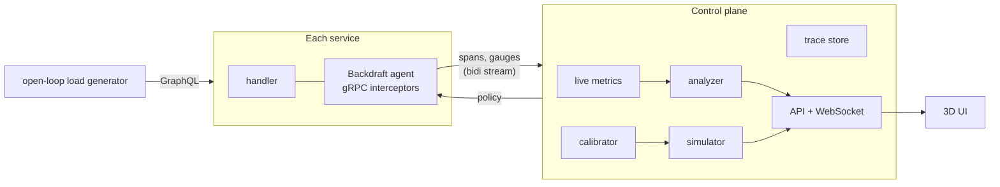

# Backdraft

**Find the retry storm before production does.**

Backdraft watches a gRPC system's real traffic, works out what its timeout
and retry policies add up to across services, and predicts, with a
simulator calibrated on that traffic, whether a short slowdown will heal by
itself or turn into an outage that outlives its cause.

It ships with a reference system (an Account / Catalog / Order shop behind a
GraphQL gateway) that it can break and fix on your laptop in one command.

```bash
go run ./cmd/lab        # five services and the control plane, no Docker
```

Then open <http://localhost:7070> and press **Play the incident** (build the
UI first, see [Running it](#running-it)).

---

## The problem

Every team sets the timeout and retry policy for its own calls, and every one
of those choices is reasonable on its own: *three attempts, 600 ms each, retry
on `UNAVAILABLE` and `DEADLINE_EXCEEDED`*. Nobody owns what they add up to.

In the reference system those local choices add up to this:

- **Retries multiply.** A user who refreshes once, a gateway that retries
  three times, and an order service that retries three times turn one
  request into up to 18 attempts on the catalog.
- **Work outlives the request that wanted it.** The order service starts a
  fresh clock for its downstream calls, so when the gateway gives up and
  retries, the abandoned attempt keeps running beside the new one.
- **Queues keep serving the dead.** Requests wait past their deadline and
  are processed anyway, so a backlog is mostly work nobody will read.

None of this shows on a healthy day. Then catalog slows down for a few
seconds: a GC pause, a noisy neighbour, a slow disk.

> At 200 req/s, about **22% of the system's capacity**, an **8-second**,
> 300 ms slowdown of catalog leaves the system at **0% success after the
> slowdown has ended**, and it stays there: the backlog keeps growing.
> Catalog is healthy, 100% busy, and almost all of its work finishes after
> the caller has given up. Retries are sustaining the overload.
>
> Switching on retry budgets, with no other change and the incident long
> over, brings it back to full health in under 20 seconds.

That is a **metastable failure**: a state the system enters through a
trigger but stays in because of a *sustaining effect*, here retry
amplification ([Bronson et al., HotOS 2021](https://doi.org/10.1145/3458336.3465286)).
A study of public post-mortems found that at least 4 of the 15 major AWS
outages of the previous decade were metastable failures, and that retries
were the most common sustaining effect
([Huang et al., OSDI 2022](https://www.usenix.org/conference/osdi22/presentation/huang-lexiang)).
It is invisible to dashboards and load tests that only ever see the healthy
state. Work on analysing it is recent
([Isaacs et al., HotOS 2025](https://www.amazon.science/publications/analyzing-metastable-failures)),
and there is little tooling a team can point at its own services.

Every number above is measured, not modelled: `go test ./internal/lab`
drives the real running system through exactly that incident and asserts
it.

## What Backdraft does

| | |
|---|---|
| **Observe** | A gRPC/HTTP agent reports every attempt and every served request as a span: attempt number, deadline, time queued, time spent in the service itself, and whether the work finished after its caller left. The UI renders the call graph live in 3D, one comet per sampled attempt: mint for first tries, amber for retries, red where a caller gave up. |
| **Diagnose** | An analyzer walks every path from the users and reports what no single service can see: the attempts one request can become, timeouts that outlast their caller's, deadlines that are dropped, writes that are retried, queues that never shed, and, from live rates, whether worst-case retry load exceeds the capacity a service needs to recover. Each finding comes with the numbers and a one-click policy patch. |
| **Predict** | A discrete-event simulator, calibrated from live traffic, replays the system under any incident. It simulates a minute of traffic in tens of milliseconds, so it can draw a **stability map** (load against incident duration, coloured by whether the system recovers) and a **hysteresis** sweep. |
| **Fix** | Policies are pushed to the agents over their control-plane sessions and apply to the next request. Retry budgets, single-layer retries, deadline propagation, shedding of expired work and bounded queues can each be switched on live, to watch what they buy. |
| **Guard** | `backdraft check policy.json` runs the same analysis without a control plane and fails the build. |

## Running it

**Lab (no Docker):** Go 1.24 and Node 22.12+ (or Node 20.19+).

```bash
cd web && npm ci && npm run build && cd ..
go run ./cmd/lab
```

Open <http://localhost:7070>. The GraphQL playground is on
<http://localhost:8080/playground>. For UI development, run `npm run dev` in
`web/` instead of building; Vite proxies to the lab.

**Real databases:** `docker compose up --build` runs the same services on
Postgres and Elasticsearch with the control plane in its own container
(<http://localhost:7070>, playground on <http://localhost:8000/playground>).

**In CI:**

```bash
go run ./cmd/backdraft check examples/reference.policy.json
```

```
CRITICAL  One request from users can become 18 attempts on account and catalog
          Along users -> gateway -> order -> account and catalog, 3 layers retry
          (users x2, gateway x3, order x3). Each layer retries the failures of the
          layer below it, so when account and catalog are slow every timeout
          fires at once and the attempts multiply ...
HIGH      order can outlast gateway's 1.5s timeout
          gateway waits 1.5s per attempt for order, but order can spend up to
          1.88s on account alone. order does not propagate the deadline, so it
          keeps calling account after gateway has given up and retried - every
          retry starts another copy of the work.
...
3 critical, 4 high, 3 medium, 0 low
exit status 1
```

The reference policy is deliberately risky so the incident can be reproduced.
For a passing CI example, use `examples/hardened.policy.json`: it adds the
mitigations, disables retries on account/product creation, and fits gateway
calls within the user's deadline.

```bash
go run ./cmd/backdraft check examples/hardened.policy.json
```

The [CI workflow](.github/workflows/ci.yml) runs on pushes to `main` and pull
requests. It checks formatting and vet, runs unit tests with Linux's race
detector, reproduces the live incident, builds the UI from the lockfile, and
builds and boots Docker Compose with Postgres and Elasticsearch. The Compose
smoke check verifies the served UI, all five agent sessions, checkout,
idempotent replays, order history, and live policy changes.

Run that same smoke check against a local lab with Python 3:

```bash
python scripts/smoke.py
# For Compose's gateway port:
python scripts/smoke.py --gateway http://127.0.0.1:8000/graphql --wait 180
```

## How it works



### The agent (`backdraft/`)

A client and a server interceptor, plus HTTP middleware for edge services.

- **Client side** owns the call: per-attempt timeout, retries with capped
  exponential backoff and full jitter, a retry budget, per-method
  `noRetry`, and deadline propagation, which can be switched off to
  reproduce the common bug of calling downstream with a fresh context.
  Every attempt is a span; a retry the budget refuses is a span too.
- **Retry budgets** follow Finagle and Linkerd: over a sliding 10-second
  window, retries may not exceed a ratio of requests plus a small floor. A
  per-request attempt cap bounds one request; a budget bounds the aggregate,
  which is what matters in an outage. The analyzer models the difference
  (per-request worst case versus *sustained* amplification).
- **Server side** admits work through a FIFO limiter whose capacity and
  queue limit change at runtime. A worker is held for the whole handler,
  downstream calls included, as in a thread-per-request server; that is how
  a slow dependency makes its callers saturate too. Deadline-aware servers
  let a waiter go the moment its caller does.
- **Self time** is measured, not assumed: the handler's time minus the
  *union* of the intervals it spent blocked on downstream calls, so
  parallel calls are not double-counted. The simulator replays it.
- Trace context is W3C `traceparent`, so spans line up with
  OpenTelemetry-instrumented hops. Telemetry goes through a bounded buffer
  and is dropped, and counted, rather than ever blocking a request.
- Policies are one JSON schema shared by the agent, the HTTP API and the CI
  checker. An agent keeps enforcing its last policy if the control plane
  goes away.

### The analyzer (`backdraft/analysis`)

Rules that only make sense across services. Each one explains itself with
numbers and, where a policy change fixes it, carries the patch; a test
checks that every patch resolves the finding it was generated for.

- **Retry amplification:** product of attempts along each path, counting
  only layers that can *sustain* multiplication, since a budgeted layer
  tops out at 1+ratio whatever its attempt count.
- **Timeout inversion:** a callee whose worst-case downstream time exceeds
  its caller's timeout. With live traffic, the worst case comes from the
  call sequences actually observed; statically, from the slowest single
  dependency, which every request touching it can hit.
- **Dropped deadlines, unsafe retries, unbudgeted retries, unbounded queues,
  no shedding.** Unsafe-retry findings are narrowed to the methods each
  edge is observed to call.
- **Retry cliff:** compares the worst-case retry load on each service with
  the throughput it can sustain when healthy (workers over observed hold
  time). When retries alone exceed it, a service that is pushed into
  overload cannot drain: that is the sustaining effect, predicted from
  configuration and live rates.

### The simulator (`backdraft/sim`)

A deterministic discrete-event model with the agent's semantics: Poisson
users who time out and refresh, per-attempt deadlines, propagation,
backoff, budgets, FIFO worker pools held across downstream calls,
deadline-aware queues and queue limits. It is calibrated from live traffic:

- the empirical distribution of each service's self time (healthy requests
  only, so the model describes the system rather than the incident),
- the downstream call shapes each method was observed to make, with
  overlapping calls grouped as parallel,
- the live request mix.

A verdict distinguishes **recovered** (and how fast), **recovering** (still
down, but the backlog is shrinking; with an estimate of when it clears) and
**metastable** (down, with the backlog holding or growing), and names the
service whose arrivals exceed its own capacity, separately from the callers
that are saturated only because they are waiting on it.

Events are a tagged union in a binary heap, and attempts and calls come
from per-run slabs: a 46-second incident with a quarter of a million events
runs in about 85 ms with a few hundred allocations, and an 80-cell
stability map takes about 1.3 s on 12 threads. Hopeless cells stop early;
a test checks that stopping early never changes a verdict.

### The control plane (`backdraft/tower`)

Holds one bidirectional stream per agent, turns spans into per-second rates
and latency histograms, keeps recent traces (with a separate ring so a
storm's healthy traffic cannot evict the evidence), learns the simulation
model, reruns the analyzer every two seconds against live observations, and
streams all of it to the UI. The load generator is **open-loop**: requests
arrive as a Poisson process whether or not earlier ones have finished. A
closed-loop generator slows down when the system does and hides exactly the
overload this tool exists to find.

## Validation

- **Agent:** limiter ordering and abandonment, budget bounds, backoff,
  traceparent, and end-to-end interceptor tests over real gRPC: retries
  reported per attempt, non-retryable codes not retried, budgets
  suppressing retries, expired work shed, deadline propagation preventing
  orphaned work, self time excluding downstream calls.
- **Analyzer:** findings on the reference policy, patches that resolve
  what they claim, observations narrowing static findings.
- **Simulator:** determinism, Little's law and the utilization law at light
  load, capacity estimation, the brownout matrix (no retries recovers,
  unbudgeted retries go metastable, *shedding alone does not save a system
  whose retries triple arrivals*, budgets recover), hysteresis, queue limits.
- **Reference system:** the headline result holds in simulation
  (`internal/reference`) and against the live system
  (`internal/lab`, about a minute; skipped with `-short`).
- **Services:** regression tests for the order-service bugs fixed in
  [the review](docs/review.md).

```bash
go test ./...            # everything, including the live incident
go test -short ./...     # skip it
```

## The reference system

The shop was a tutorial-grade microservices example. [docs/review.md](docs/review.md)
reviews it in detail: order history that silently re-priced itself, unknown
products dropped from orders, a panic on a missing catalog document,
downstream timeouts reported as "account not found", orders that could be
placed twice by a retry, money in `MONEY` columns summed as floats. All
fixed, with tests. Its resilience policies in
[`internal/reference`](internal/reference/policy.go) are deliberately
ordinary: what a team writes when it configures each hop on its own.

## Limits, honestly

- **Unary RPCs only.** Streaming calls pass through uninstrumented.
- **Lab capacity is synthetic.** Services sleep for a configured service
  time while holding a worker, which models a resource-bound service
  deterministically on any laptop. Real services reveal their own self
  time; the calibrator uses whatever it observes.
- **One process per service.** Gauges sum across instances, but the
  simulator models each service as one pool.
- **The model is a model.** It captures queueing, retries and deadlines;
  it does not model connection pools, GC or memory pressure. The live
  incident above and the simulated one agree on the outcome, which is the
  claim; they will not agree to the millisecond.
- **The control plane API is unauthenticated.** It can change live
  policy, so it binds to localhost and accepts WebSocket origins from
  localhost only. Put it behind your own auth before exposing it.
- **Docker is validated by the Compose CI job.** The original development
  machine has no Docker installation; check the job's result for the current
  commit before relying on that path.

## Related work

Netflix's [ChAP and Monocle](https://arxiv.org/abs/1905.04648) automate
fault-injection experiments in production and prioritise them by
criticality. Linkerd, Envoy and Finagle implement retry budgets. Gremlin
and Chaos Mesh inject faults. Backdraft's angle is narrower: the
cross-service arithmetic of timeouts and retries, a sustaining-effect check
that runs on configuration plus live rates, and a calibrated simulator
that turns "this looks risky" into the load and incident size beyond which
the system no longer recovers on its own.

## Layout

```
backdraft/            agent: interceptors, limiter, budget, tracing
backdraft/analysis/   cross-service policy analysis and patches
backdraft/sim/        discrete-event simulator, stability map, hysteresis
backdraft/tower/      control plane: sessions, metrics, traces, calibration, API
cmd/backdraft/        `backdraft serve` and `backdraft check`
cmd/lab/              the whole reference system in one process
internal/reference/   the reference system's policies and static model
internal/lab/         lab wiring and the live end-to-end test
account/ catalog/ order/ graphql/   the reference services
web/                  the UI (React, three.js)
```
