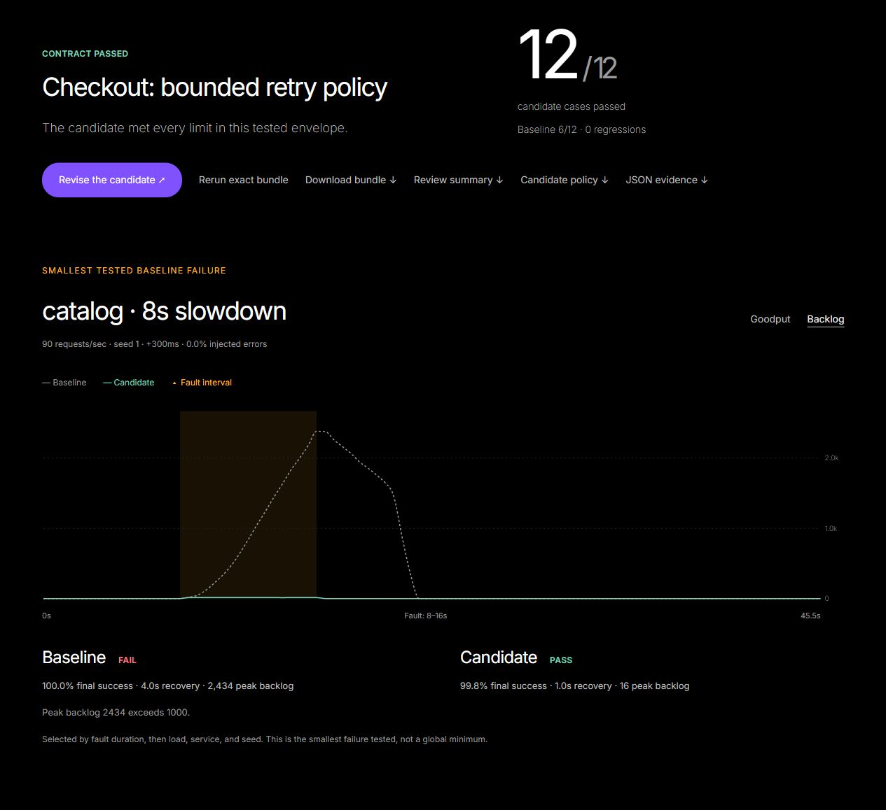
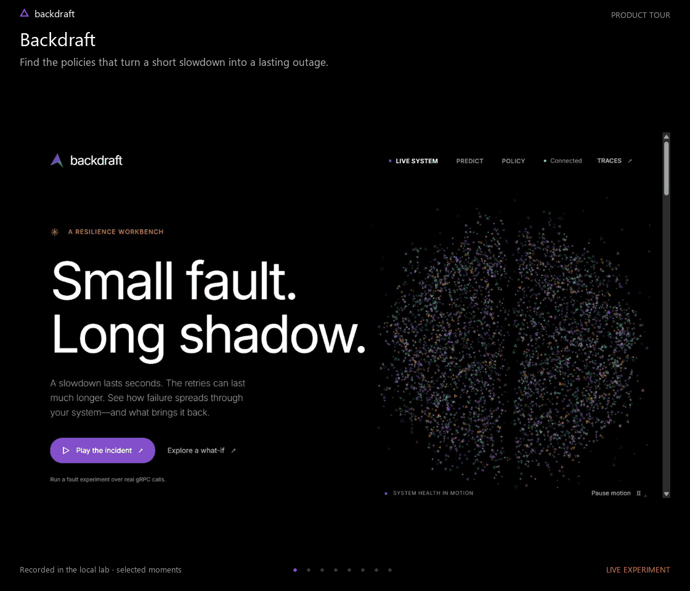

# Backdraft

Review retry, timeout, and queue policies before deploying them.

Backdraft captures a model of your Go/gRPC services, tests a proposed policy
against a recovery contract, and saves the evidence as a portable review.
The same bundle runs in the UI or offline in CI. No live faults are injected
by a policy review.

[](https://github.com/SanishKumar/Backdraft-go-microservices/actions/workflows/ci.yml)

## A policy change with evidence



1. **Capture** healthy traffic: request mix, downstream call shapes, service
   times, and the current policy.
2. **Propose** a policy and define the loads, fault durations, and random seeds
   it must survive.
3. **Review** both policies under identical incoming traffic. Check success,
   recovery time, and peak backlog for every case.
4. **Keep the counterexample.** Each review includes the smallest tested
   failure, policy diff, time series, input hashes, and a Markdown summary.
5. **Gate the change.** Commit the bundle and rerun it against the policy in
   your branch. Failed or incomplete reviews return a nonzero exit code.

The included checkout envelope has 12 paired cases: the reference policy
passes six; the proposed policy passes all twelve. This is a result for the
declared example model, not a production benchmark.

## Try a review

Requires Go 1.24.1+; no running services or Node.js are needed for the CLI.

```sh
git clone https://github.com/SanishKumar/Backdraft-go-microservices.git
cd Backdraft-go-microservices
go run ./cmd/backdraft review examples/checkout.review.json
go run ./cmd/backdraft review --format markdown --out report.json examples/checkout.review.json
```

Change a queue limit, retry count, or timeout in the bundle's `candidate`,
then run it again. The baseline model stays frozen. To review an external
policy file, use `--candidate candidate.policy.json`.

## Open the workspace

Build a portable executable with its UI. Requires Node.js 22.12+ and Python 3
in addition to Go.

```sh
python scripts/build.py
./dist/backdraft demo
```

On Windows, run `./dist/backdraft.exe demo`. Open
[localhost:7070](http://localhost:7070), wait for healthy traffic, and choose
**Capture your system**. The executable includes the UI, reference services,
and CLI; it can be copied to another machine with the same OS and architecture.

Reviews are saved in `.backdraft/reviews` and survive restarts. Use `--data`
to select another directory. Reference shop data and live telemetry remain
in memory. The [portable-build workflow](.github/workflows/package.yml) also
produces Linux, macOS, and Windows executables with SHA-256 checksums.

For frontend development, build the UI separately:

```sh
npm --prefix web ci
npm --prefix web run build
go run ./cmd/lab
```

## Explore a live incident



A 30-second tour recorded in the local lab, with pauses shortened. Catalog
slows for eight seconds; retries keep the system overloaded after the fault
clears. A retry budget restores service. The final views compare policy
predictions and map the failure boundary across loads and fault durations.

[View the static screenshot](docs/images/backdraft.png).

In **Live system**, choose **Play the incident**. The lab starts a GraphQL
gateway, three gRPC services, a traffic generator, and the control plane.

The experiment slows Catalog for eight seconds at 200 requests per second,
then enables retry budgets. The charts show whether the system recovers and
how long it takes. Timing and capacity vary by machine.

## Workspace

| View | Use |
| --- | --- |
| **Reviews** | Capture or import a model, compare a candidate across a fault envelope, inspect failures, and export evidence for CI. Saved history survives restarts. |
| **Live** | Follow request attempts, queues, success rate, and wasted work. Inject latency or errors, inspect traces, and apply a finding's policy patch. |
| **Predict** | Compare a slowdown under the current and mitigated policies. Sweep load and incident duration in a stability map, or ramp traffic up and down. |
| **Policy** | Edit per-hop timeouts, attempts, backoff, retry budgets, deadline propagation, worker counts, and queue limits. Export a policy for CI. |

The live workspace moves from request metrics and the call graph to fault
experiments and policy findings. Select a service to inspect its queues and
deadlines, or open Traces for individual request waterfalls. The animated
constellation can be paused and respects reduced-motion preferences.

The reference policy is intentionally unsafe so the incident can be reproduced.
`examples/hardened.policy.json` provides a separate configuration with bounded
queues, propagated deadlines, and retries restricted to safe operations.

## Policy checks

Run the analyzer without starting any services:

```sh
go run ./cmd/backdraft check examples/hardened.policy.json
go run ./cmd/backdraft check --format json examples/reference.policy.json
```

The checker detects retry amplification, timeout inversions, dropped deadlines,
unsafe write retries, missing retry budgets, and unbounded queues. Findings
include an explanation and, where available, a configuration patch.

Exit codes: `0` passes, `1` exceeds the severity threshold, and `2` indicates
invalid input. The default threshold is `high`; set `--fail-on` to `critical`,
`high`, `medium`, `low`, or `none`.

## Connect a service

Install a Backdraft interceptor on each unary gRPC client and server, then
start a reporting session:

```go
policy := backdraft.ServiceConfig{
    Server: backdraft.ServerPolicy{
        Workers: 32, QueueLimit: 128, ShedExpired: true,
    },
    Clients: map[string]backdraft.ClientPolicy{
        "catalog": {
            TimeoutMs: 500, MaxAttempts: 2,
            BackoffMs: 25, BackoffMaxMs: 100,
            RetryOn: []string{"UNAVAILABLE"},
            PropagateDeadline: true,
            Budget: &backdraft.BudgetPolicy{Ratio: 0.1},
        },
    },
}
agent := backdraft.New("checkout", policy)
go agent.Run(ctx, "127.0.0.1:7071")

server := grpc.NewServer(agent.ServerOptions()...)
conn, err := grpc.NewClient(catalogAddress, agent.DialOptions("catalog")...)
```

Import `github.com/SanishKumar/go-microservices/backdraft`. Use stable service
names on both ends of an edge. The client policy owns retries; account for
any retries already configured in another transport layer. Declare method
idempotency in `ServiceConfig.Methods` and exclude unsafe operations with
`ClientPolicy.NoRetry`.

With a portable build, run the standalone control plane:

```sh
backdraft serve --entry checkout
```

HTTP listens on `127.0.0.1:7070`; reporting gRPC listens on
`127.0.0.1:7071`. The built-in traffic generator is disabled unless
`--load-target` is supplied. An instrumented service retains its last policy
when the control plane disconnects.

Send traffic to the entry service to populate its model. Predictions become
available after enough request samples arrive. The standalone control plane
uses the services that connect to it; it does not add the reference shop to
your topology.

Capture a review from the CLI and gate a candidate:

```sh
backdraft capture --name checkout-retries --out checkout.review.json
backdraft review --require-capture --max-model-age 168h --candidate candidate.policy.json --out report.json checkout.review.json
```

Capture requires connected, fault-free services. Incomplete service-time or
request-shape calibration produces an **inconclusive** review, even if the
simulation meets the contract. See [policy reviews](docs/policy-reviews.md)
for calibration requirements, contract semantics, and a CI example.

## Docker

```sh
docker compose up --build
```

This runs the reference services with Postgres and Elasticsearch. The UI is
at [localhost:7070](http://localhost:7070); the GraphQL playground is at
[localhost:8000/playground](http://localhost:8000/playground).

The Compose configuration is for local development. Its database credentials
and resilience policies are examples. Existing databases from the original
shop schema require migration before use with the current order schema.

## Development

Start the lab, then run `npm run dev` in `web/`. Vite proxies API requests
and the live stream to port 7070.

```sh
go test -short ./...          # unit and integration tests
go test ./internal/lab        # live failure and recovery experiment
go vet ./...
python -B -m unittest discover -s scripts -p "test_*.py"
cd web
npm run typecheck
npm run build
```

`python scripts/smoke.py` checks a running lab. For Compose, add
`--gateway http://127.0.0.1:8000/graphql --wait 180`.
The smoke check pauses traffic, clears faults and policy edits, and drains
work left by earlier experiments before testing checkout. Avoid changing
controls while it runs. On success it restores the original traffic settings
with the reference policy; on failure it leaves traffic paused for diagnosis.
[CI](.github/workflows/ci.yml) also runs Linux race detection and the
Compose smoke check against real databases.

## Scope

Backdraft is a local-first developer tool for unary Go/gRPC service graphs.
It is not a hosted management service or a production reliability certificate.

- Unary RPCs are instrumented. Streaming RPCs pass through unchanged.
- Traces, configuration overrides, and calibration are held in memory.
  Captured reviews and their results are persisted separately. Compose uses
  a named volume for reviews; `docker compose down -v` removes it.
- In standalone mode, ingress rates are derived from completed server spans;
  they do not measure arrivals that have not finished or telemetry that was dropped.
- The control plane has no authentication or TLS. Keep its ports private.
- The simulator models each service as one worker pool. It does not model
  per-instance routing, connection pools, garbage collection, or memory pressure.
- Predictions depend on observed traffic and request shapes. A reported
  failure means the model did not recover within the observation window;
  it is not proof of an indefinite outage.
- A passing review covers the frozen model and finite envelope in its bundle.
  It does not test arbitrary traffic, simultaneous faults, or unobserved paths.
  Re-capture after topology, workload, or service implementation changes.
- The lab uses synthetic service times to make overload reproducible without
  consuming a laptop's CPU. Capacity figures are specific to that model.

See [architecture](docs/architecture.md) for the model and instrumentation,
and [service changes](docs/review.md) for the reference system's data and API
corrections.
